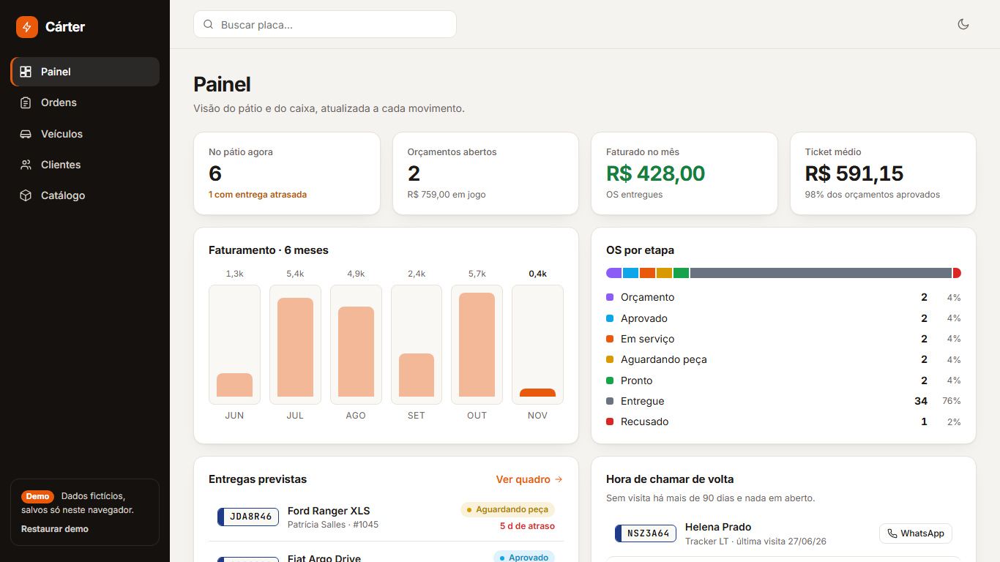
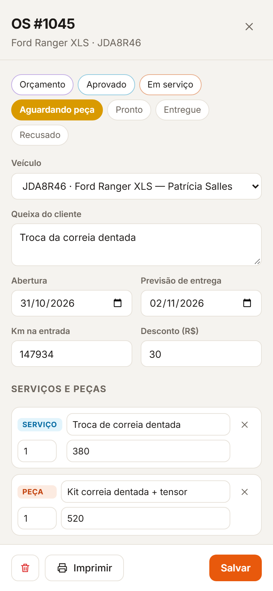
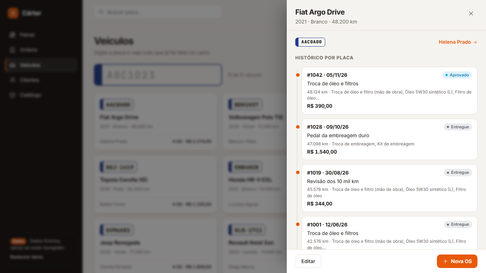
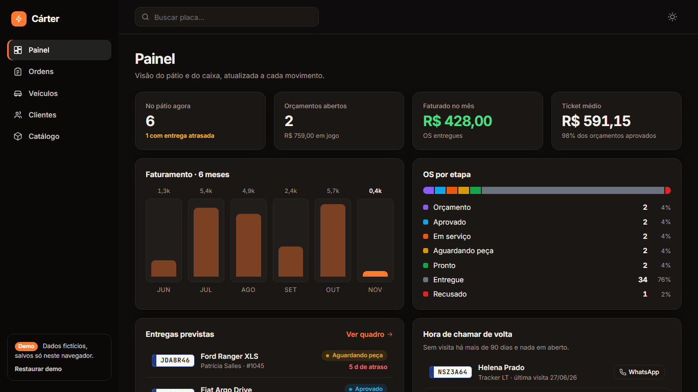
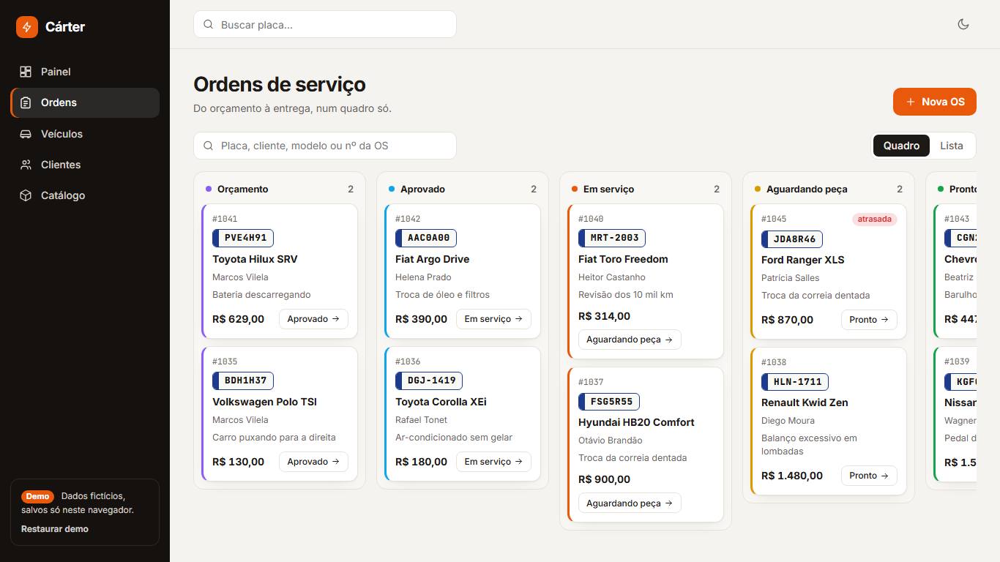

# Cárter — workshop CRM & work orders

A lightweight CRM for independent auto repair shops: customers, vehicles, estimates, work orders, parts and services, and a **full service history by license plate**. Built with SolidJS and TypeScript.

**Live demo:** https://alissonlittig.github.io/carter-oficina-crm/

> All data is fictional and generated on first load. Nothing leaves the browser (state is kept in `localStorage`). The UI is in Brazilian Portuguese, since the target audience is Brazilian workshops.



## What it does

- **Dashboard** — cars in the shop, open estimates and their value, monthly revenue, average ticket, 6-month revenue chart, work orders by stage, late deliveries, and a "call them back" list (no visit in 90+ days, with a prefilled WhatsApp link).
- **Work orders** — Kanban board (estimate → approved → in service → waiting for part → ready → delivered) plus a list view with filters. Open an order to edit the complaint, dates, mileage, line items (labor/parts), discount and notes; totals update live. Printable.
- **Plate search** — type a plate (Mercosul or old format) and see the vehicle and its whole timeline of past orders, mileage progression and spend.
- **Customers** — contact, vehicles, lifetime spend, order history.
- **Catalog** — services and parts with list prices; add them to an order with one click.
- Light/dark theme, responsive down to 390 px (bottom navigation on phones), keyboard-friendly, reduced-motion aware.

| Order drawer (mobile) | Plate history | Dark theme |
|---|---|---|
|  |  |  |



## Stack

SolidJS 1.9 (fine-grained signals + `createStore`), TypeScript (strict), Vite, Vitest. No UI library, no chart library: charts and icons are hand-written SVG/CSS. Fonts (Inter, JetBrains Mono) are self-hosted via Fontsource. Production JS is ~20 kB gzipped.

## Run it

```bash
npm ci
npm run dev      # http://localhost:5173
npm test         # unit tests (plates, totals, status flow)
npm run build    # type-check + production build into dist/
```

Lighthouse (production build, mobile): Performance 100 · Accessibility 98 · Best Practices 100 · SEO 91.

## Structure

```
src/
  types.ts   domain types        util.ts   money, plates, totals, status flow (+ tests)
  seed.ts    fictional demo data store.ts  reactive store persisted to localStorage
  nav.ts     hash routing & drawers
  views/     Painel, Ordens, Veiculos, Clientes, Catalogo
```

## Notes

- Persistence is client-only by design for the demo; swapping `store.ts` for an API is the intended next step.
- Plates are validated as `ABC1D23` (Mercosul) or `ABC1234` (legacy); duplicates are rejected.

Author: Alisson Littig · Information Management student at UFPR.
